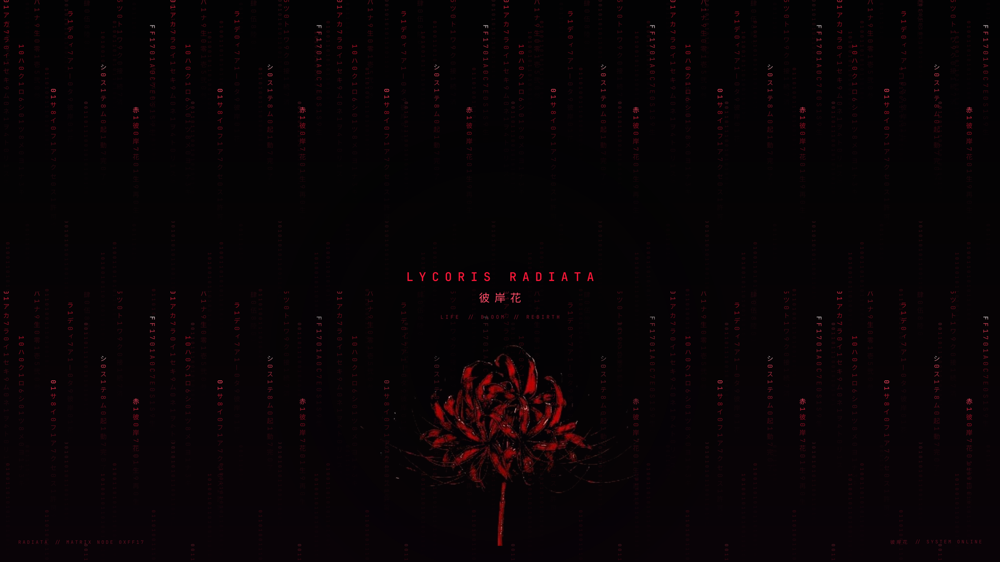

<div align="center">

# Radiata

### Red Matrix Theme for Ubuntu GNOME

**GTK · GNOME Shell · GDM · Icons · Cursors · Terminal · Lycoris radiata**

[](LICENSE)




</div>

Radiata is a red matrix cyberpunk **Ubuntu GNOME theme**. It packages a dark **GTK theme**, **GNOME Shell theme**, **GDM theme**, floating dock, red system controls, custom icon and cursor themes, terminal styling, and a 4K matrix-rain wallpaper built around *Lycoris radiata* (彼岸花).

## Features

- **Complete desktop identity:** GTK 3, GTK 4, libadwaita overrides, GNOME Shell, Ubuntu Dock, and GDM.
- **Black and red Shell UI:** panel, overview, app grid, notifications, calendar, quick settings, dialogs, search, and lock screen.
- **Floating dock:** fully transparent dock background with restrained running indicators and no hover tiles.
- **Custom icon layer:** folders and common Ubuntu applications, with Papirus Dark fallback for full coverage.
- **Custom cursor family:** pointer, link, text, busy, move, resize, help, and forbidden states at four sizes.
- **4K wallpaper:** red matrix rain, Japanese typography, and a centered spider lily.
- **Terminal suite:** Radiata palette for Ptyxis, JetBrains Mono, Bash prompt, btop theme, fastfetch layout, and red cmatrix alias.
- **Reversible installation:** original settings and touched user files are recorded before modification.

The preview above shows the included Radiata wallpaper artwork.

## Compatibility

| Component | Status |
|---|---|
| Ubuntu 26.04 LTS | Tested during development |
| GNOME Shell 50 | Tested during development |
| Wayland | Supported and tested |
| X11 | Expected to work; not fully verified |
| Other Ubuntu/GNOME releases | Best effort; private Shell selectors can change |
| Non-GNOME desktops | Not supported |

Radiata checks for missing GSettings keys and skips unavailable options, but GNOME Shell CSS and GDM resources remain release-specific interfaces.

## Install

Clone the repository and run the installer as your normal desktop user:

```bash
git clone <repository-url>
cd radiata
chmod +x install.sh uninstall.sh
./install.sh
```

Log out and back in once after installation. Wayland cannot reload GNOME Shell in place, and GDM reads the new login theme at the next logout or reboot.

If all dependencies are already installed:

```bash
./install.sh --skip-packages
```

### What uses `sudo`

The installer requests administrator access only to:

1. Install named packages from configured Ubuntu repositories.
2. Copy the generated GDM resource and wallpaper under `/usr/local/share`.
3. Register the GDM resource through Ubuntu's `gdm-theme.gresource` alternatives group.

Run `install.sh` as your desktop account, **not** with `sudo ./install.sh`.

## Uninstall

```bash
./uninstall.sh
```

The uninstaller restores recorded GNOME and Ptyxis values, original user configuration files, local Snap launcher overrides, and the prior GDM alternative. Packages installed through APT remain installed because other applications may use them.

Recovery state is stored at:

```text
~/.local/state/radiata/
```

Do not delete that directory while Radiata is installed.

## Included components

| Installed component | Name or location |
|---|---|
| GTK/Shell theme | `~/.themes/Radiata-Glass` |
| Icon theme | `~/.local/share/icons/Radiata-Icons` |
| Cursor theme | `~/.local/share/icons/Radiata-Cursor` |
| Generated data | `~/.local/share/radiata` |
| GTK 4 integration | `~/.config/gtk-4.0/radiata.css` |
| Ptyxis palette | `Radiata` |
| btop theme | `radiata` |
| fastfetch configuration | `~/.config/fastfetch/radiata.jsonc` |
| GDM resource | `/usr/local/share/gnome-shell/radiata-gdm-theme.gresource` |

## Application icons

Radiata includes original red compatibility icons for Firefox, Files, Terminal, Settings, Calculator, Disks, Text Editor, System Monitor, App Center, VS Code, Telegram, Camera, Calendar, Clocks, Resources, VLC, Spotify, GParted, Document Viewer, Image Viewer, and Disk Usage Analyzer.

Papirus Dark supplies icons that Radiata does not override. Snap launchers that use absolute image paths receive reversible local `.desktop` overrides.

## Customize

Edit `theme.conf` and rerun `./install.sh`:

```bash
ACCENT="#ff1738"
ACCENT_BRIGHT="#ff4d68"
ACCENT_DIM="#7d1428"
BG="#07080a"
FONT="JetBrains Mono"
```

Do not rename installed component variables directly. Run `./uninstall.sh`, change the names, and install again so the recovery manifest remains accurate.

Source layout:

```text
assets/cursors/               Cursor SVG sources
assets/icons/                 Application and system icon SVGs
assets/wallpaper/             Committed wallpaper image assets
templates/wallpaper.svg       Editable 4K composition
templates/gtk-overrides.css   GTK and libadwaita rules
templates/shell-overrides.css GNOME Shell, panel, dock, and menus
templates/gdm-overrides.css   Login and lock-screen rules
lib/common.sh                 Shared backup and safety functions
install.sh                    One-command installer
uninstall.sh                  Recovery and removal script
```

## Terminal commands

After opening a new terminal:

```bash
sys       # Radiata fastfetch layout
matrix    # Red cmatrix
monitor   # Radiata btop theme
```

## Known limitations

- Websites control their own colors. Radiata cannot force arbitrary pages into dark mode.
- Sandboxed Snap and Flatpak applications may isolate host themes or cursors.
- Application updates can replace absolute Snap icon paths; rerun the installer to refresh local overrides.
- GNOME Shell does not provide general CSS backdrop blur. Radiata uses alpha compositing, dark surfaces, and restrained shadows.
- Upgrading GNOME may rename private Shell selectors or change the GDM resource layout.

## Contributing and support

- [Contribution guide](CONTRIBUTING.md)
- [Support guide](SUPPORT.md)
- [Security policy](SECURITY.md)
- [Code of Conduct](CODE_OF_CONDUCT.md)
- [Changelog](CHANGELOG.md)

## License

Radiata's code, templates, documentation, artwork, icons, and cursors are released under the [MIT License](LICENSE).

Radiata is an independent community project. Product names and trademarks belong to their respective owners; no affiliation or endorsement is implied.

## GitHub topics

`ubuntu-theme` `gnome-shell-theme` `gtk-theme` `gdm-theme` `linux-rice` `cyberpunk-theme` `matrix-theme` `red-theme` `cursor-theme` `icon-theme` `lycoris-radiata`
